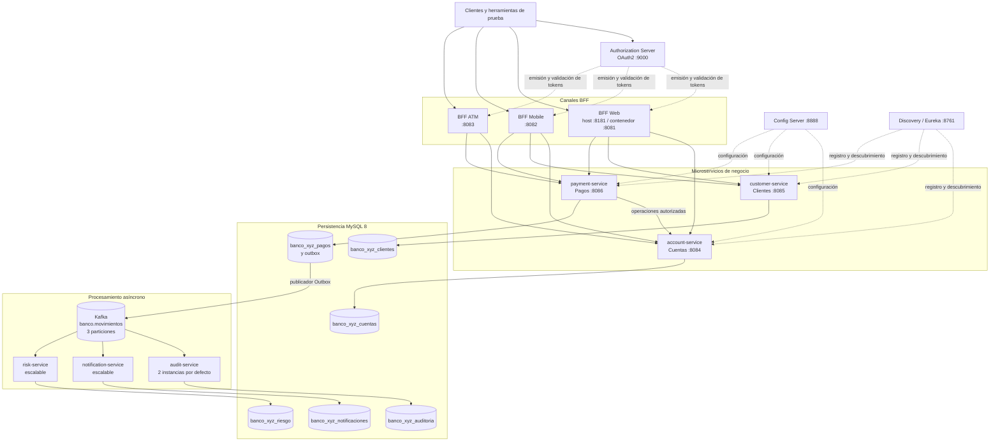
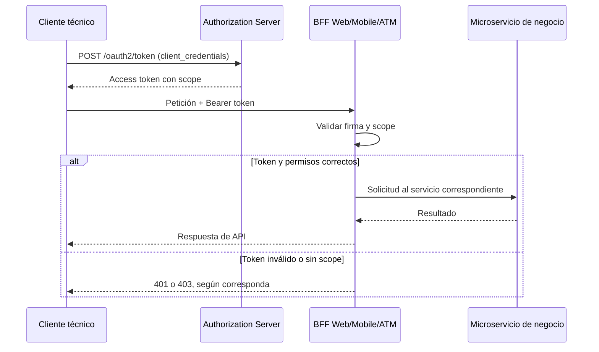
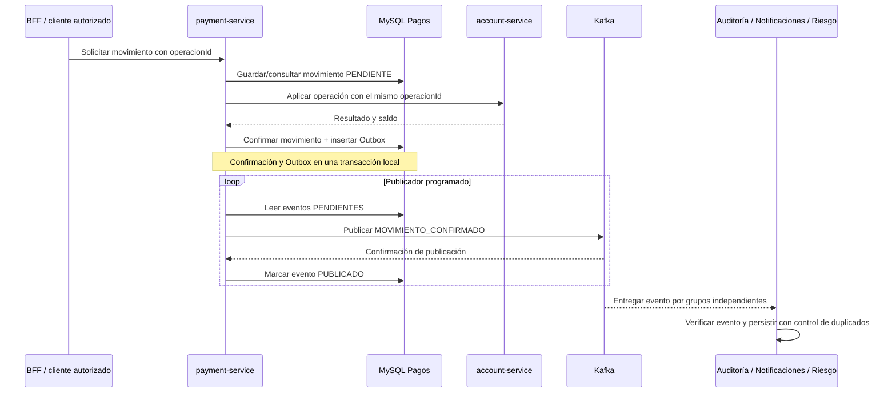
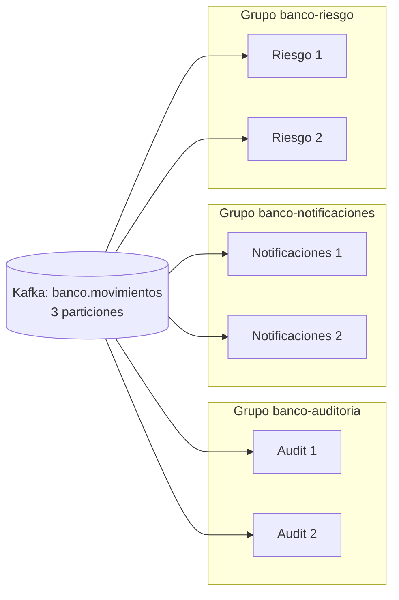
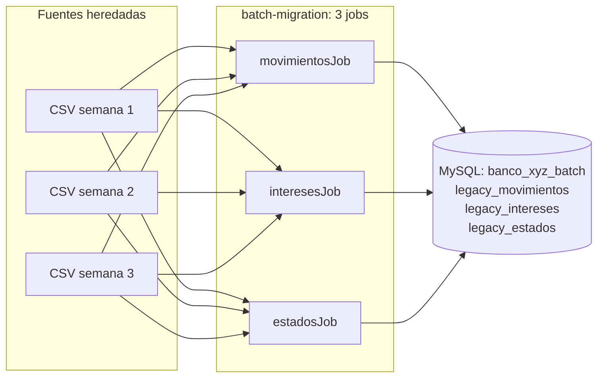

# Diagrama de Arquitectura — Banco XYZ

**Asignatura:** Desarrollo Backend III (PBY2203)\
**Evaluación:** Experiencia 3 — Semana 9\
**Rama de referencia:** [`semana9-pablo`](https://github.com/poblo-13/Banco-XYZ/tree/semana9-pablo)\
**Versión revisada:** commit `50953c8` (10 de octubre de 2026)

## 1. Vista general

La versión de Semana 9 separa las responsabilidades bancarias en **Cuentas**, **Clientes** y **Pagos**. Conserva los tres BFF, OAuth2, Config Server y Eureka. Kafka distribuye eventos a **Auditoría**, **Notificaciones** y **Riesgo**, mientras **Spring Batch** procesa datos heredados de forma independiente.

> Los diagramas están escritos en Mermaid y se visualizan directamente en GitHub. `bank-core-api` permanece en el repositorio como componente **legado** y no se inicia con el perfil predeterminado de Docker Compose.

**Lectura:** las flechas continuas representan conexiones lógicas. La emisión de tokens OAuth2 no significa que el servidor de autorización intermedie cada solicitud. Las rutas entre BFF y microservicios muestran dependencias posibles; cada endpoint utiliza únicamente las necesarias.

## 2. Componentes y puertos

| Módulo / infraestructura | Puerto publicado en host | Responsabilidad |
|---|---:|---|
| `authorization-server` | 9000 | Emisión de tokens OAuth2, flujo `client_credentials` |
| `config-server` | 8888 | Configuración centralizada |
| `discovery-server` | 8761 | Registro Eureka |
| `bff-web` | **8181** | Consultas y dashboard Web; escucha en 8081 dentro del contenedor |
| `bff-mobile` | 8082 | Consultas resumidas para móvil |
| `bff-atm` | 8083 | Consultas de saldo y retiros |
| `account-service` | 8084 | Cuentas, saldos y operaciones |
| `customer-service` | 8085 | Datos de clientes |
| `payment-service` | 8086 | Movimientos, confirmación y Outbox |
| `audit-service` | Sin HTTP publicado | Auditoría asíncrona en MySQL |
| `notification-service` | Sin HTTP publicado | Persistencia de notificaciones |
| `risk-service` | Sin HTTP publicado | Evaluación básica de riesgo |
| `batch-migration` | No es servicio HTTP | Migración de CSV heredados con Spring Batch |
| MySQL | 3307 → 3306 | Bases de datos de los dominios |
| Kafka | 9092 | Tópico `banco.movimientos` |
| `bank-core-api` **legado** | 8080 con perfil `legacy` | Implementación anterior, conservada para referencia |

El archivo `pom.xml` contiene **14 módulos Maven**. `batch-migration` se ejecuta como proceso separado; no aparece en los servicios levantados por el `docker-compose.yml` principal.

## 3. Seguridad y separación por canal

Scopes principales: `WEB_ACCESS`, `MOBILE_ACCESS` y `ATM_ACCESS`. La versión Semana 9 también define clientes técnicos adicionales para `CLIENTES_WRITE`, `CUENTAS_OPERAR`, `PAGOS_WRITE` y `PAGOS_READ` según sus operaciones. El flujo `client_credentials` identifica clientes/servicios, no usuarios bancarios finales.

## 4. Flujo de movimiento confirmado: consistencia y Outbox

El contrato utilizado por los consumidores de Semana 9 identifica el evento `MOVIMIENTO_CONFIRMADO` y contiene `operacionId`, `cuentaId`, `tipo` y `monto`. El publicador Kafka utiliza **`operacionId` como key**. Esto es distinto al flujo anterior del `bank-core-api` legado, que documentaba eventos como `RETIRO_REALIZADO` y agrupación por `cuentaId`.

**Garantía y límite:** Outbox evita perder la intención de publicar entre la confirmación local y el envío asíncrono; el consumo debe tolerar entregas duplicadas. La operación entre `payment-service` y `account-service` no es una transacción distribuida única, por lo que se emplean identificadores de operación y estados para recuperación.

## 5. Tres consumidores independientes de Kafka

El diagrama muestra la **configuración de seis instancias utilizada en la prueba de escalamiento**; el `docker-compose.yml` base declara dos servicios de auditoría y una instancia de notificaciones y riesgo. La prueba documentada escaló estos últimos a dos réplicas cada uno. Dentro de cada grupo, las particiones se reparten entre instancias; los grupos son independientes y reciben cada uno los eventos publicados.

## 6. Migración Spring Batch

Cada job tiene tres pasos (uno por semana), organizados en flujos paralelos con `SimpleAsyncTaskExecutor` y límite de **tres flujos simultáneos**. Los pasos utilizan procesamiento por chunks, validación de registros, escritura idempotente por `(semana, linea)` y reintentos ante fallos transitorios de acceso a datos. Los registros inválidos se conservan con estado `RECHAZADO` y motivo de rechazo.

## 7. Infraestructura y alcance

- **Docker Compose:** levanta servicios HTTP, consumidores Kafka, MySQL y Kafka, con persistencia mediante volúmenes.
- **MySQL:** un servidor con bases lógicas separadas por dominio; no se trata de múltiples servidores físicos.
- **Kafka:** un broker de desarrollo y tres particiones; factor de replicación 1, sin alta disponibilidad.
- **Config Server / Eureka:** componentes de soporte disponibles para los servicios configurados; no sustituyen OAuth2 ni Kafka.
- **Circuit Breakers:** los BFF mantienen protección frente a fallas en llamadas descendentes; la versión Semana 9 llama a servicios separados, no al Core legado.
- **AWS:** cualquier despliegue remoto debe presentarse como pendiente, salvo que exista una evidencia específica de ejecución.

## 8. Archivos que sustentan los diagramas

- [`docker-compose.yml`](docker-compose.yml): servicios, redes, volúmenes, puertos y perfil `legacy`.
- [`pom.xml`](pom.xml): 14 módulos Maven.
- [`payment-service/.../MovimientoService.java`](payment-service/src/main/java/com/bancoxyz/payment/service/MovimientoService.java): estados e idempotencia operativa.
- [`payment-service/.../OutboxPublisher.java`](payment-service/src/main/java/com/bancoxyz/payment/messaging/OutboxPublisher.java): publicación programada de Outbox.
- [`risk-service/.../RiskConsumer.java`](risk-service/src/main/java/com/bancoxyz/risk/RiskConsumer.java): análisis de riesgo.
- [`batch-migration/.../ParallelBatchFlows.java`](batch-migration/src/main/java/com/bancoxyz/batch/ParallelBatchFlows.java): paralelismo Spring Batch.
- [`docs/EVIDENCIA-KAFKA-SEMANA9.md`](docs/EVIDENCIA-KAFKA-SEMANA9.md): escalamiento observado.

---

**Conclusión:** Semana 9 evoluciona desde un Core único hacia servicios de dominio separados, conserva los BFF y la seguridad OAuth2, agrega consumidores independientes de eventos y formaliza la migración de información heredada mediante Spring Batch. La arquitectura es reproducible en un entorno local de desarrollo y tiene límites explícitos de disponibilidad, seguridad y despliegue.
